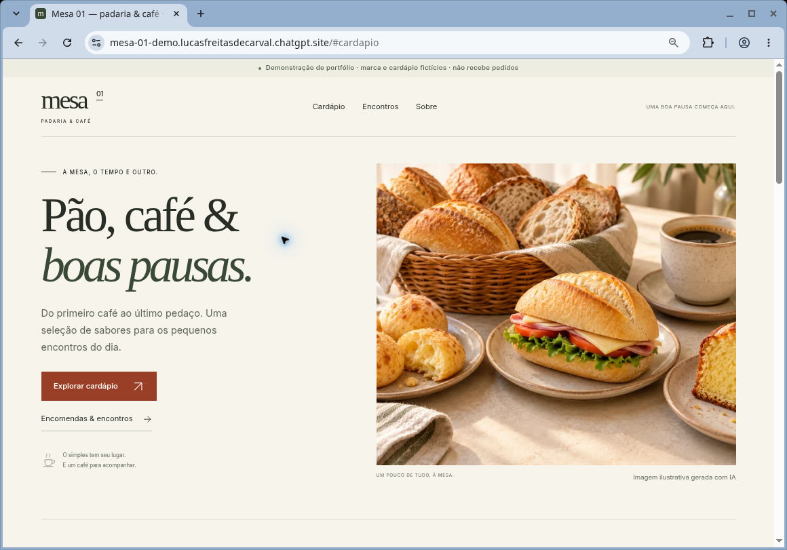

# Mesa 01 — cardápio demonstrativo

Uma experiência editorial de padaria e café: cardápio responsivo, busca acessível e simulação local de uma solicitação. **Mesa 01, seus itens e preços são inteiramente fictícios.** Este projeto de portfólio não representa um estabelecimento real e não recebe pedidos, pagamentos, reservas ou mensagens.

**Demonstração pública:** [Abrir Mesa 01](https://mesa-01-demo.lucasfreitasdecarval.chatgpt.site) · **Código:** [GitHub](https://github.com/lucasfdcarvalho/mesa-01-cardapio-demo).

A versão final foi revisada em Chromium nos recortes descritos em [Validação](docs/QA.md).

## Prévia



Veja também o [cardápio no mobile](docs/screenshots/mobile-menu.jpg) e o [cardápio no tablet](docs/screenshots/tablet-menu.jpg). São capturas reais, sem retoque, de uma janela isolada do navegador; as medidas de viewport e os limites da revisão estão em [Validação](docs/QA.md).

## Recursos

- Dez itens em três categorias, busca que ignora acentos e capitalização, contagem de resultados e recuperação do estado vazio.
- Cardápio completo no HTML, legível mesmo sem JavaScript.
- Simulador com ocasião, quantidade de pessoas e data opcionais; prévia e cópia de texto, sem envio.
- Navegação por âncoras, foco visível, diálogo nativo com Escape e retorno de foco, além de respeito à preferência por movimento reduzido.
- Ilustração identificada como gerada com IA, imagens responsivas e fonte hospedada localmente.

## Executar localmente

Requer **Node.js 20 ou superior** e npm. Não há dependências de aplicação ou desenvolvimento a instalar; `npm install` não é necessário.

Na pasta do projeto, estes comandos funcionam em Bash, PowerShell e Prompt de Comando:

```sh
npm run build
npm test
npm run dev
```

Abra [localhost:4179](http://localhost:4179). Encerre o servidor com `Ctrl+C`.

| Comando | Resultado |
| --- | --- |
| `npm run build` | Gera o HTML completo e copia CSS/JavaScript para `dist/`. |
| `npm test` | Executa os testes com o test runner nativo do Node. |
| `npm run check` | Reconstrói o site e executa todos os testes. |
| `npm run dev` | Serve a pasta `dist/` para revisão local; não faz build automático. |

A porta padrão é `4179` e a interface padrão é `0.0.0.0`. Para limitar o servidor à própria máquina e usar outra porta:

**Bash / zsh**

```sh
PORT=4180 HOST=127.0.0.1 npm run dev
```

**Windows PowerShell**

```powershell
$env:PORT = "4180"
$env:HOST = "127.0.0.1"
npm run dev
```

Nesse exemplo, abra `http://localhost:4180`. As variáveis do PowerShell permanecem na sessão até serem removidas ou a janela ser fechada. Em ambientes isolados, o servidor e o navegador precisam compartilhar o contexto de rede ou usar o encaminhamento de porta apropriado. O servidor de desenvolvimento não é destinado à produção.

## Organização

```text
src/                  HTML-base, CSS e JavaScript da aplicação
  data/menu.js        Cardápio fictício
  lib/catalog.js      Normalização, filtros, agrupamento e preços
  lib/composer.js     Validação e composição do texto de exemplo
  lib/form-events.js  Sincronização da validade nativa da data
scripts/build.mjs     Build estático, sem downloads
scripts/serve.mjs     Servidor local de revisão
tests/                Testes unitários e verificações estáticas
dist/                 Site pronto e ativos locais versionados
docs/                 Proveniência, adaptação e validação
.openai/hosting.json   Configuração do projeto de hospedagem do proprietário
```

Edite `src/`, não os arquivos gerados. O build preserva as imagens, a fonte e a licença em `dist/assets/`; **não apague `dist/` antes do build**, pois esses ativos são entradas versionadas, não arquivos baixados pelo script.

## Hospedagem estática

Publique **o conteúdo de `dist/` na raiz do site**. Os caminhos de ativos começam com `/assets/`; hospedagem sob um subdiretório exige uma adaptação explícita, não contemplada nesta versão. Não há etapa de servidor ou função de backend.

`.openai/hosting.json` contém o identificador do projeto Sites do proprietário e aponta para `dist`. Esse identificador **não é uma credencial** e não concede permissão de publicação. Preserve-o ao atualizar o projeto original. Em uma cópia independente, configure seu próprio destino autorizado; não reutilize o projeto de hospedagem do proprietário.

Os scripts locais não publicam, não enviam código remoto e não criam recursos externos. O meta `noindex, nofollow` pede que buscadores não indexem a demonstração; **não restringe acesso nem torna um site privado**.

## Privacidade e limites

Não há API, backend, autenticação, pagamento, bibliotecas externas de interface, cookies, analytics, incorporações externas ou persistência. A aplicação não coleta nem transmite dados. A infraestrutura de hospedagem pode manter seus próprios registros operacionais; o projeto não implementa telemetria.

- Não informe dados pessoais. O simulador não pede nome, contato ou mensagem livre.
- Abrir e fechar o diálogo limpa a simulação. Copiar é uma ação opcional para a área de transferência local.
- O texto não é enviado, não calcula orçamento nem confirma pedido, disponibilidade ou prazo.
- Os valores são exemplos de cardápio, não uma oferta comercial ou proposta de serviços.
- A imagem é ilustrativa e não retrata produtos de um negócio real.

## Ativos e licenciamento

A fonte Inter é distribuída com sua [SIL Open Font License 1.1](dist/assets/fonts/Inter-LICENSE.txt), que deve ser preservada. A ilustração foi gerada para esta demonstração; não foram incorporados ativos ou identidade de clientes. Consulte a [proveniência dos ativos](docs/ASSETS.md).

Este repositório não inclui uma licença open-source para o código do projeto. A publicação para consulta não atribui uma nova licença aos arquivos; a fonte mantém sua licença própria.

Veja também o [guia de adaptação responsável](docs/REUSE.md) e os [resultados e limites da validação](docs/QA.md).
